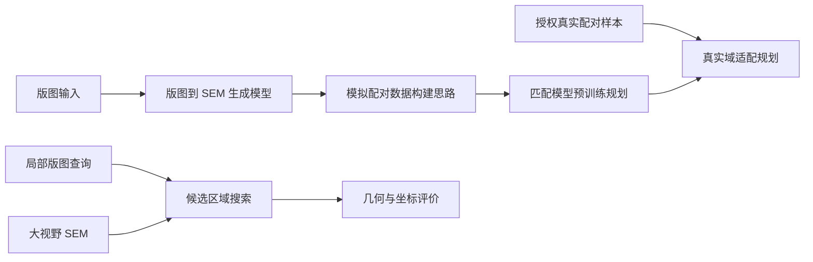

# Layout–SEM Generation and Localization

版图与扫描电子显微镜（SEM）图像之间的生成、结构转换与局部定位研究代码。

本项目关注一个通用问题：如何在大视野 SEM 图像中寻找局部版图对应的位置。仓库展示算法组织、训练与评价逻辑，以及基于成熟开源模型的工程适配。仅包含脱敏源码和说明，不提供数据、图像、训练权重或内部实验结果。

## 项目结构

| 模块 | 入口 | 主要内容 |
| --- | --- | --- |
| 版图到 SEM 生成 | `generation/train_bridge.py` | 布朗桥扩散模型训练、EMA、验证与采样 |
| SEM 结构转换 | `matching/sem_abc_train.py` | CycleGAN 与水平垂直翻转一致性约束对照 |
| 数据协议检查 | `matching/sem_abc_prepare.py` | 用户本地样本清单校验、空间划分检查 |
| 定位评价 | `matching/sem_abc_evaluate.py` | 固定匹配器下的候选区域评价 |
| 传统匹配基线 | `matching/sem_layout_baseline_a.py` | 多尺度边缘相关与 SIFT 几何匹配 |

## 通用技术路线



本仓库中的可学习网络用于图像生成和结构转换，定位后端包含传统匹配基线。可学习匹配网络的预训练与真实域微调是后续路线，不代表已经在此仓库完成。图像生成质量与定位正确率需要分别验证。

## 我的工作

- 承接现场需求，将局部版图定位问题拆解为数据条件、模型任务与评价标准。
- 调研图像生成、跨模态转换和局部匹配方法，确定分阶段验证路线。
- 在开源模型基础上，借助 AI 辅助开发训练、推理、对照实验和结果检查流程。
- 围绕尺度变化、结构失真及重复图案歧义设计诊断，并整理技术文档。
- 向导师提出补充实测图像和对接实验室的建议，推动所需资源的协调。

核心网络包含第三方实现；本项目的工作集中在任务适配、实验流程、约束比较和评价组织。这里不声称从零编写全部网络，也不将局部约束实验称为完整复现某篇论文。

## 阅读与使用

建议先阅读 `matching/sem_layout_baseline_a.py`，再看结构转换训练，最后阅读扩散模型训练入口。

```bash
# 只查看命令说明，不读取数据或启动训练
python generation/train_bridge.py --help
python matching/sem_abc_prepare.py --help

# 使用程序内临时几何图案检查坐标计算，不访问任何外部数据集
python matching/sem_layout_baseline_a.py selftest
```

这是代码展示版本，不是开箱即用的训练发行包。完整训练需要自行准备有使用权限的数据、模型配置以及适配的 PyTorch CUDA 环境。生成入口使用 `--data` 和 `--config` 指定本地输入；匹配准备入口使用 `--pairs`、`--mosaic-dir` 和 `--root`。仓库不包含这些输入。

匹配脚本保留内部参数名称：`A` 为原始 SEM 基线，`B` 为 CycleGAN，`C` 为带水平垂直翻转一致性约束的 CycleGAN。后两者采用共同初始化与抽样顺序组织对照，需依次运行。翻转一致性分支仅实现对应约束，不是完整 SPPE-GAN。

## 评价边界

- 生成外观、结构保真和最终定位正确性是不同目标。
- 基于文件元数据的参考框是评价代理，不能直接证明像素级配准或纳米级精度。
- 重复结构可能导致多位置歧义，需要额外上下文与合理评价协议。
- 这里不发布商业项目的性能数值、客户验证结论或部署承诺。

## 第三方代码与权利说明

`generation/BBDM/` 保留上游 BBDM 模块及原有 MIT 许可证；`matching/third_party/cyclegan/` 保留 CycleGAN 作者实现及原许可证。各文件中的其他上游引用和署名均保留。

本仓库没有为项目适配代码额外授予统一的开源许可证；公开可见不代表所有代码均可任意再许可。第三方代码以各自许可证为准。

## 发布范围

仅源码与说明。未包含数据集、原始或生成图像、版图文件、模型权重、样本清单、实验日志、内部报告、访问凭据或原项目 Git 历史。后续材料按具体需求单独审核，不在本次发布范围内。
